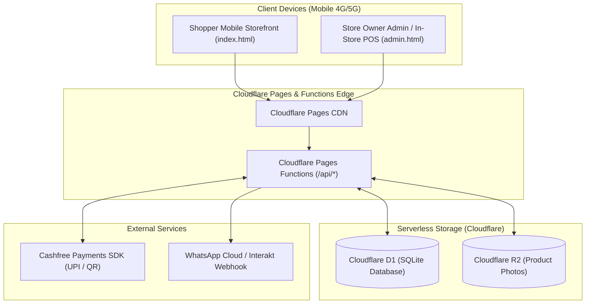

# 📋 BMAD Implementation Plan: Cloudflare Native Boutique E-Commerce

**Project:** `ecomtemplatecloudflare`  
**Architecture:** 100% Serverless Edge E-Commerce (Cloudflare Pages + D1 Database + R2 Storage + Functions API)  
**Cost:** ₹0 / $0 per month forever (Free Tier covers 5M D1 reads/day, 100k writes/day, 10GB R2 storage).

---

## 🏗️ Architecture Blueprint

---

## 📦 Phase-by-Phase BMAD Roadmap

### 🧱 Epic 1: Database Architecture & D1 SQLite Schema
* **Story 1.1 — Schema Definition (`schema.sql`)**
  * `products`: Core product entity (title, slug, category, description, price, sale_price, image_front, image_back, sku).
  * `product_variants`: Size variations (`size`: XS, S, M, L, XL, XXL) with `stock_qty` and zero-backorder tracking.
  * `orders`: Customer checkout details (order_id, customer_name, phone, city, pincode, total_amount, payment_status, tracking_awb, courier, created_at).
  * `order_items`: Order line items with size and price snapshots.
  * `settings`: Key-value store for announcement bar, free shipping threshold, urgency threshold, and WhatsApp number.
* **Story 1.2 — Catalog Seeder (`seed.sql`)**
  * Seed initial Kaka by Eliza catalog pieces (Green Floral Flare Kurthi, Amber Leaf Dress, Red Printed Peplum Top, etc.) with exact size stock.

---

### ⚡ Epic 2: Cloudflare Functions Edge API
* **Story 2.1 — Product Catalog API (`functions/api/products.js`)**
  * `GET /api/products`: Fast edge fetch of all products with their nested size variants.
  * `POST /api/products`: Create new boutique piece with photos, prices, and size stock.
* **Story 2.2 — Stock Matrix & In-Store POS API (`functions/api/stock.js`)**
  * `PATCH /api/stock`: Atomic update of variant stock quantity for the quick Matrix and in-store counter register (decrements stock immediately to prevent double-selling).
* **Story 2.3 — Store Settings API (`functions/api/settings.js`)**
  * `GET /api/settings`: Returns announcement bar text, free shipping threshold, and urgency limit.
  * `POST /api/settings`: Updates settings from Admin Hub.

---

### 💳 Epic 3: Cashfree UPI Payment & Webhook Automation
* **Story 3.1 — Create Order Session (`functions/api/checkout/create-order.js`)**
  * Creates order record in D1 with `payment_status = 'PENDING'`.
  * Calls Cashfree Orders API to generate `payment_session_id` for instant UPI (GPay, PhonePe, Paytm).
* **Story 3.2 — Webhook Stock Decrement & WhatsApp (`functions/api/checkout/webhook.js`)**
  * Verifies Cashfree webhook signature.
  * Marks order `PAID` / `PROCESSING`.
  * **Atomically decrements stock** in `product_variants` in D1.
  * Dispatches automated WhatsApp notification payload to store webhook.

---

### 📷 Epic 4: Cloudflare R2 Media Storage
* **Story 4.1 — Direct Photo Upload Engine (`functions/api/upload.js`)**
  * Handles image upload directly to Cloudflare R2 bucket (`PHOTOS`).
  * Generates clean public CDN URL for product front & hover photos.

---

### 📱 Epic 5: Frontend & Mobile Command Center Integration
* **Story 5.1 — Storefront Wireup (`public/index.html`)**
  * Connects product grid to live `/api/products`.
  * Live stock urgency bar calculated dynamically from D1 size stock.
  * Checkout form connected to `/api/checkout/create-order`.
* **Story 5.2 — Mobile Command Center & POS Wireup (`public/admin.html`)**
  * Stock Matrix with live stepper saves to `/api/stock`.
  * In-Store POS Register with 1-tap counter sale linked to D1 atomic decrement.
  * Add Product screen uploading photos to R2 and publishing to D1.

---

### 🛡️ Epic 6: BMAD Security Hardening & Anti-Tampering Protection
* **Story 6.1 — Anti-Fake Order Cryptographic Verification (`functions/api/checkout/webhook.js`)**
  * HMAC-SHA256 signature verification over `timestamp + rawBody` using Web Crypto API.
  * Idempotency safeguard prevents duplicate stock deductions from webhook retries.
* **Story 6.2 — Server-Authoritative Pricing Guard (`functions/api/checkout/create-order.js`)**
  * Strict database price lookup per item ID; rejects client-altered `total_amount`.
  * Pre-checkout stock validation prevents phantom orders for sold-out variants.
* **Story 6.3 — Role-Based API Authorization (`x-admin-key`)**
  * Protection of `/api/orders`, `/api/stock`, `/api/products` (POST), `/api/settings` (POST), and `/api/upload` (POST) against unauthorized access and customer PII leakage.
